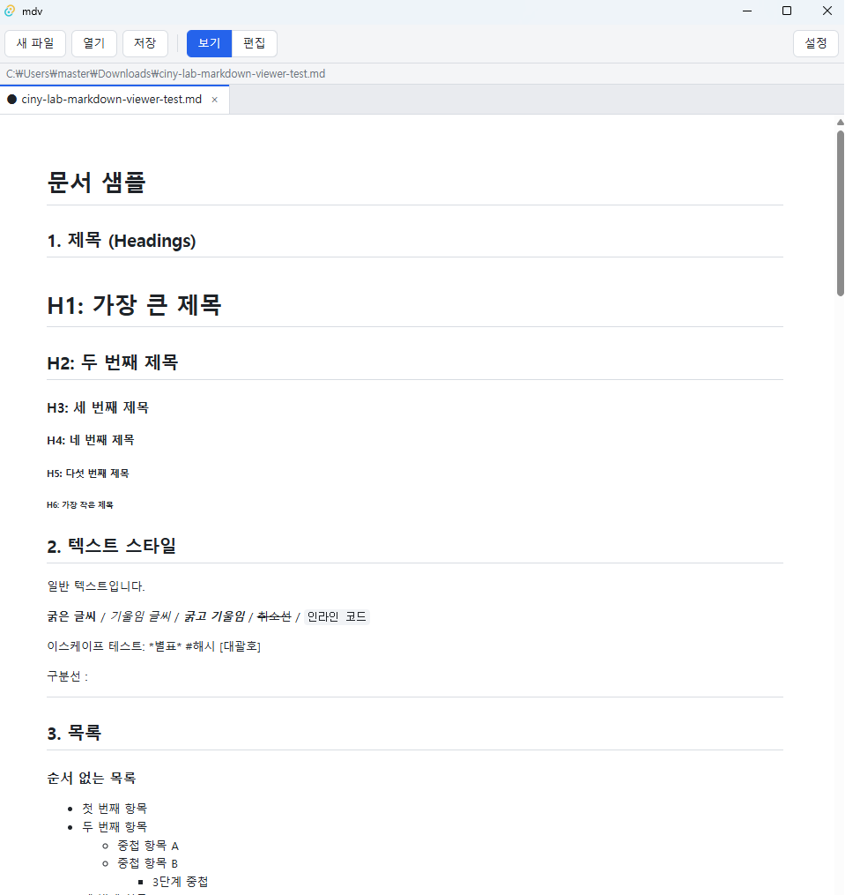

# mdv — Markdown Viewer

Tauri 2 + TypeScript로 만든 가벼운 데스크톱 Markdown 뷰어/편집기입니다.
`.md` 파일을 더블클릭하면 바로 열리고, 보기 모드와 편집 모드를 오가며 문서를 확인하고 수정할 수 있습니다.



## 주요 기능

### 보기 / 편집

- **보기 모드**: Markdown을 렌더링해서 보여줍니다.
- **편집 모드**: CodeMirror 6 기반 편집기 (Markdown 문법 강조, 줄 번호, 검색 등 기본 기능 포함)
- 보기 모드에서 체크박스(`- [ ]`)를 클릭하면 원본 파일의 해당 줄만 `[ ]` ↔ `[x]`로 바뀝니다.
  - 수정 중인 내용이 없으면 바로 저장하고, 수정 중이면 "수정됨" 표시만 합니다.

### 탭

- 여러 파일을 탭으로 열 수 있습니다. 이미 열린 파일을 다시 열면 기존 탭으로 이동합니다.
- 수정된 탭에는 `●` 표시가 붙습니다.
- 저장하지 않은 탭을 닫으면 경고하고, 한 번 더 누르면 닫습니다.
- 저장하지 않은 내용이 있는 상태로 창을 닫으면 종료 확인 창이 뜹니다.

### 파일 열기 / 저장

- 열기 대화상자, 명령줄 인자, **기본 프로그램 지정(파일 연결)** 으로 열기를 지원합니다.
- 단일 인스턴스: 앱이 이미 실행 중일 때 다른 파일을 열면 기존 창에 새 탭으로 열립니다.
- 지원 확장자: `md`, `markdown`, `mdx`, `txt` (최대 10MB)
- 새 파일은 저장할 때 경로를 고르며, 확장자가 없으면 `.md`가 붙습니다.
- 저장은 임시 파일에 쓴 뒤 교체하므로 저장 중 종료되어도 원본이 손상되지 않습니다.

### 지원하는 Markdown 문법

| 항목 | 지원 | 비고 |
|---|:---:|---|
| 제목 H1~H6, 굵게/기울임/취소선, 인라인 코드 | ✅ | |
| 순서 있는/없는 목록, 중첩 목록 | ✅ | |
| 체크박스 (GFM Task list) | ✅ | 보기 모드에서 클릭으로 토글 |
| 인용문 (중첩 포함) | ✅ | |
| 표 (열 정렬 포함) | ✅ | |
| 링크 / 자동 링크 / 참조형 링크 | ✅ | 앱 안에서 페이지 이동은 하지 않음 |
| 각주 | ✅ | `markdown-it-footnote` |
| 코드 블록 문법 강조 | ✅ | 아래 언어 목록 참고 |
| HTML 태그 (`<details>`, `<u>`, `<mark>` 등) | ❌ | 보안을 위해 텍스트로 표시 |
| 외부 URL 이미지 | ❌ | CSP로 차단 |
| 수식 (LaTeX) | ❌ | 원문 그대로 표시 |
| Mermaid 다이어그램 | ❌ | 코드 블록으로 표시 |

코드 블록 문법 강조 언어 (highlight.js):
`java`, `javascript`(`js`, `jsx`), `typescript`(`ts`), `sql`, `yaml`(`yml`), `bash`(`sh`, `shell`, `zsh`), `json`, `xml`(`html`), `css`, `rust`
그 외 언어는 강조 없이 일반 코드 블록으로 표시됩니다.

전체 문법 렌더링은 [sample_docs.md](./sample_docs.md)로 확인할 수 있습니다.

### 설정

오른쪽 위 **설정** 버튼에서 바꿀 수 있으며, 다음 실행에도 유지됩니다.

- 테마: 시스템 / 라이트 / 다크
- 글꼴 크기: 13 ~ 20
- 편집기 줄 바꿈 켜기/끄기

### 단축키

Windows/Linux는 `Ctrl`, macOS는 `Cmd`를 사용합니다.

| 단축키 | 동작 |
|---|---|
| `Ctrl + E` | 보기 / 편집 모드 전환 |
| `Ctrl + S` | 저장 |
| `Ctrl + O` | 파일 열기 |
| `Ctrl + N` | 새 파일 |
| `Ctrl + W` | 현재 탭 닫기 |

### 보안

- 본문 HTML은 렌더링하지 않으므로 문서 안의 스크립트가 실행되지 않습니다.
- 파일 읽기/쓰기는 사용자가 열기·저장 대화상자나 실행 인자로 직접 지정한 파일만 허용합니다.
- 허용된 확장자(`md`, `markdown`, `mdx`, `txt`) 외의 파일은 열거나 저장할 수 없습니다.

## 빌드

### 사전 준비

- [Node.js](https://nodejs.org/) (LTS 권장)
- [Rust](https://www.rust-lang.org/tools/install) (stable, edition 2024 지원 버전)
- Tauri 2 플랫폼별 사전 요구사항 — [Tauri Prerequisites](https://v2.tauri.app/start/prerequisites/)
  - Windows: Microsoft C++ Build Tools, WebView2 (Windows 10/11은 기본 설치됨)

### 의존성 설치

```bash
npm install
```

### 개발 모드 실행

```bash
npm run tauri dev
```

Vite 개발 서버(`http://localhost:1420`)와 함께 앱이 실행되며, 프런트엔드 변경 사항이 바로 반영됩니다.

### 배포용 빌드

```bash
npm run tauri build
```

빌드 결과물은 아래 위치에 생성됩니다.

- 실행 파일: `src-tauri/target/release/`
- 설치 파일: `src-tauri/target/release/bundle/` (Windows는 `msi`, `nsis` 폴더)

### 테스트

```bash
# 프런트엔드 (렌더링, 체크박스 토글)
npm test

# Rust (파일 접근 허용 목록, 실행 인자 해석)
cd src-tauri
cargo test
```

## 기본 프로그램으로 지정하기 (Windows)

1. `.md` 파일을 마우스 오른쪽 버튼으로 클릭 → **연결 프로그램** → **다른 앱 선택**
2. **PC에서 앱 찾기**를 눌러 설치된 mdv 실행 파일을 선택
3. **항상 이 앱을 사용하여 .md 파일 열기**를 체크

이후 `.md` 파일을 더블클릭하면 mdv로 열리고, 이미 실행 중이면 기존 창에 새 탭으로 추가됩니다.

## 프로젝트 구조

```text
md-viewer/
├─ index.html              # 화면 레이아웃
├─ src/                    # 프런트엔드 (TypeScript)
│  ├─ main.ts              # 부팅, 툴바, 저장, 단축키 연결
│  ├─ render.ts            # markdown-it 렌더링, 체크박스 토글
│  ├─ viewer.ts            # 보기 모드
│  ├─ editor.ts            # 편집 모드 (CodeMirror)
│  ├─ tabs.ts              # 탭 상태
│  ├─ open.ts              # 파일 열기 진입점
│  ├─ settings.ts          # 설정 (테마, 글꼴 크기, 줄 바꿈)
│  └─ keys.ts              # 단축키 정의
└─ src-tauri/              # 백엔드 (Rust)
   └─ src/
      ├─ lib.rs            # 앱 설정, 단일 인스턴스, 창 닫기 처리
      ├─ fs_cmds.rs        # 파일 열기/저장, 허용 목록
      ├─ open_args.rs      # 실행 인자 처리 (파일 연결)
      └─ platform/         # OS별 코드
```

## 기술 스택

- [Tauri 2](https://v2.tauri.app/) / Rust
- TypeScript / [Vite](https://vite.dev/)
- [markdown-it](https://github.com/markdown-it/markdown-it) (+ footnote, task-lists 플러그인)
- [highlight.js](https://highlightjs.org/)
- [CodeMirror 6](https://codemirror.net/)
