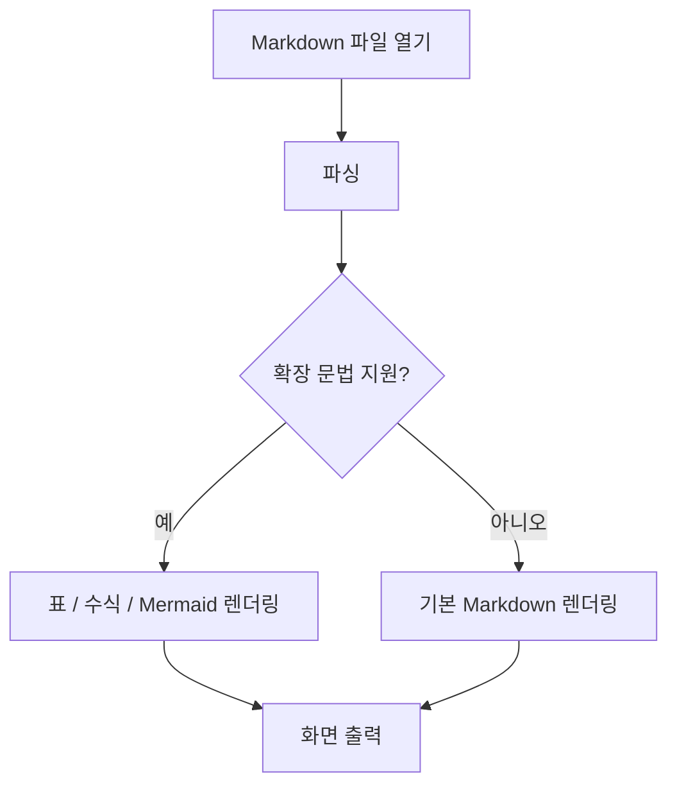
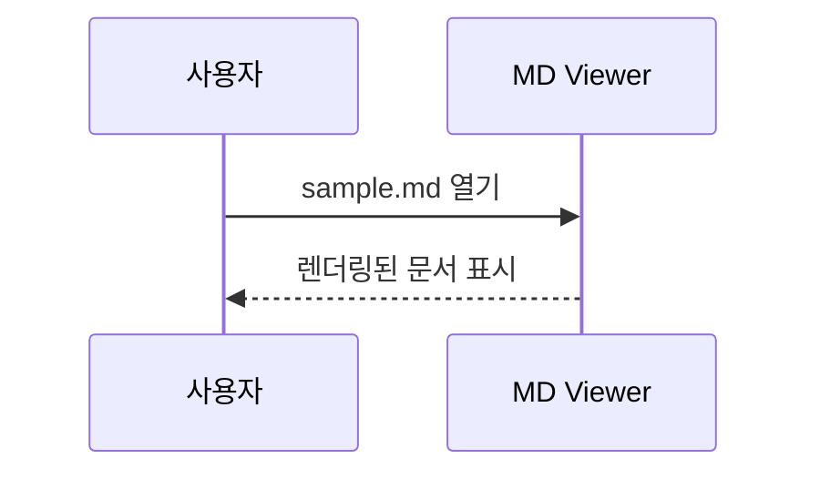

# 🧪 ciny-lab Markdown Viewer 테스트 문서

> **목적:** Markdown 뷰어가 기본 문법, 확장 문법, 코드 블록, 표, 이미지 및 다이어그램을 정상적으로 렌더링하는지 확인합니다.
>
> 작성일: 2026-10-28 · 버전: 1.0

---

## 1. 제목 (Headings)

# H1: 가장 큰 제목
## H2: 두 번째 제목
### H3: 세 번째 제목
#### H4: 네 번째 제목
##### H5: 다섯 번째 제목
###### H6: 가장 작은 제목

---

## 2. 텍스트 스타일

일반 텍스트입니다.

**굵은 글씨** / *기울임 글씨* / ***굵고 기울임*** / ~~취소선~~

`인라인 코드` / <u>밑줄(HTML 지원 시)</u> / <mark>하이라이트(HTML 지원 시)</mark>

이스케이프 테스트: \*별표\* \#해시 \[대괄호\]

한 문단의 첫 줄입니다.  
끝에 공백 두 개를 넣어 강제 줄바꿈한 둘째 줄입니다.

별도의 문단은 빈 줄로 구분합니다.

---

## 3. 목록

### 순서 없는 목록

- 첫 번째 항목
- 두 번째 항목
  - 중첩 항목 A
  - 중첩 항목 B
    - 3단계 중첩
- 세 번째 항목

### 순서 있는 목록

1. 프로젝트 생성
2. 기능 구현
3. 테스트
   1. 단위 테스트
   2. 통합 테스트
4. 배포

### 체크박스 (GFM)

- [x] 제목 렌더링
- [x] 코드 블록 테스트
- [ ] Mermaid 지원 확인
- [ ] PDF 내보내기 테스트

---

## 4. 인용문

> Markdown은 읽기 쉽고 작성하기 쉬운 경량 마크업 언어입니다.
>
> 여러 문단의 인용문도 표시할 수 있습니다.
>
> > 중첩 인용문입니다.

---

## 5. 링크 및 이미지

- 일반 링크: [GitHub](https://github.com)
- 자동 링크: <https://www.markdownguide.org/>
- 이메일 링크: <hello@example.com>
- 문서 내 이동: [표 섹션으로 이동](#6-표-tables)
- 참조형 링크: [Markdown Guide][md-guide]

[md-guide]: https://www.markdownguide.org/basic-syntax/

### 외부 이미지


> 이미지가 표시되지 않으면 뷰어의 원격 이미지 로딩 정책 또는 네트워크 연결을 확인하세요.

### 상대 경로 이미지 (의도적인 미존재 예시)


> `./assets/sample-image.png`는 파일이 없으면 깨진 이미지로 나타납니다. 상대 경로 처리 및 대체 텍스트를 테스트하는 항목입니다.

---

## 6. 표 (Tables)

| 기능 | 상태 | 점수 | 비고 |
|:---|:---:|---:|---|
| 제목 | ✅ 완료 | 100 | 왼쪽 정렬 |
| 표 | 🔄 진행 중 | 80 | 가운데/오른쪽 정렬 |
| Mermaid | ⏳ 확인 필요 | 0 | 확장 기능 |
| 이미지 | ✅ 완료 | 95 | 외부 URL |

### 긴 텍스트 셀

| ID | 설명 |
|---|---|
| A-001 | 아주 긴 문장이 들어가는 셀입니다. 화면 폭이 좁아질 때 줄바꿈 또는 가로 스크롤이 제대로 처리되는지 확인합니다. |
| A-002 | `inline code`, **bold**, *italic* |

---

## 7. 코드 블록 및 문법 강조

### JavaScript

```javascript
async function fetchStatus(url) {
  const response = await fetch(url);
  if (!response.ok) throw new Error(`HTTP ${response.status}`);
  return response.json();
}

fetchStatus('/api/health').then(console.log).catch(console.error);
```

### Python

```python
from dataclasses import dataclass

@dataclass
class Tool:
    name: str
    active: bool = True

print(Tool(name="markdown-viewer"))
```

### Bash

```bash
#!/usr/bin/env bash
set -euo pipefail
printf 'Hello, %s!\n' 'ciny-lab'
git status --short
```

### JSON

```json
{
  "project": "markdown-viewer",
  "organization": "ciny-lab",
  "features": ["tables", "highlighting", "mermaid"],
  "enabled": true,
  "version": 1
}
```

### Diff

```diff
- const theme = 'light';
+ const theme = 'dark';
  const autoSave = true;
```

### 코드 펜스 안 특수문자

```text
# 이 줄은 제목이 아닙니다.
**이 텍스트는 굵게 표시되지 않아야 합니다.**
<script>alert('do not execute')</script>
```

---

## 8. 수식 (LaTeX, 선택 기능)

인라인 수식: $E = mc^2$

블록 수식:

$$
\sum_{i=1}^{n} i = \frac{n(n+1)}{2}
$$

행렬:

$$
A = \begin{bmatrix}1 & 2 \\ 3 & 4\end{bmatrix}
$$

> 수식이 문자 그대로 나타난다면 KaTeX 또는 MathJax 통합 여부를 확인하세요.

---

## 9. Mermaid 다이어그램 (선택 기능)

### 흐름도



### 시퀀스 다이어그램



> Mermaid 미지원 뷰어에서는 코드 블록으로 보이는 것이 정상일 수 있습니다.

---

## 10. 각주 (Footnotes, 확장 기능)

Markdown 뷰어에서는 각주를 지원할 수도 있습니다.[^note1]

[^note1]: 이것은 각주 내용입니다. GitHub Flavored Markdown에서 지원합니다.

---

## 11. 접기 / 펼치기 (HTML 지원 시)

<details>
<summary>여기를 눌러 상세 내용 펼치기</summary>

숨겨진 **Markdown** 내용입니다.

- 첫 번째 설명
- 두 번째 설명

</details>

---

## 12. 긴 문서 및 특수문자

한글: 안녕하세요, 반갑습니다.  
영문: The quick brown fox jumps over the lazy dog.  
숫자: 0123456789  
기호: & © ™ → ← ↑ ↓ ± × ÷  
이모지: 🧪 🚀 ✅ ⚠️ 📦 🔧

긴 URL: https://example.com/very/long/path/for/testing/overflow/handling/in/a/markdown/viewer/with/a/long/query?parameter=abcdefghijklmnopqrstuvwxyz0123456789

---

## 13. 보안 동작 확인 (권장)

아래 코드는 **실행되면 안 됩니다.** HTML 렌더링이 가능한 뷰어라면 미리보기 내용을 정제(sanitize)하거나 신뢰할 수 없는 HTML을 비활성화하세요.

```html

<a href="javascript:alert('XSS')">위험한 링크 예시</a>
<script>alert('XSS')</script>
```

> 위 예제는 안전하게 코드 블록으로만 표시되어야 합니다.

---

## 14. 최종 점검 체크리스트

- [x] 제목 H1~H6의 크기가 구분된다.
- [ ] 굵게/기울임/취소선/인라인 코드가 표시된다.
- [ ] 중첩 목록과 체크박스가 표시된다.
- [ ] 표의 열 정렬과 긴 셀 처리가 정상이다.
- [ ] 코드 블록의 들여쓰기와 언어별 강조가 유지된다.
- [ ] 외부 링크가 올바르게 열린다.
- [ ] 원격 이미지/상대 경로 이미지 처리가 적절하다.
- [ ] 문서 내 앵커 링크가 동작한다.
- [ ] 수식이 렌더링되거나 명확하게 폴백된다.
- [ ] Mermaid가 렌더링되거나 코드로 표시된다.
- [ ] 각주와 details 지원 여부를 확인했다.
- [ ] 긴 URL과 좁은 화면에서 레이아웃이 깨지지 않는다.
- [ ] 비신뢰 HTML이나 스크립트가 실행되지 않는다.

**테스트 완료!** 🎉
